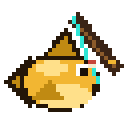
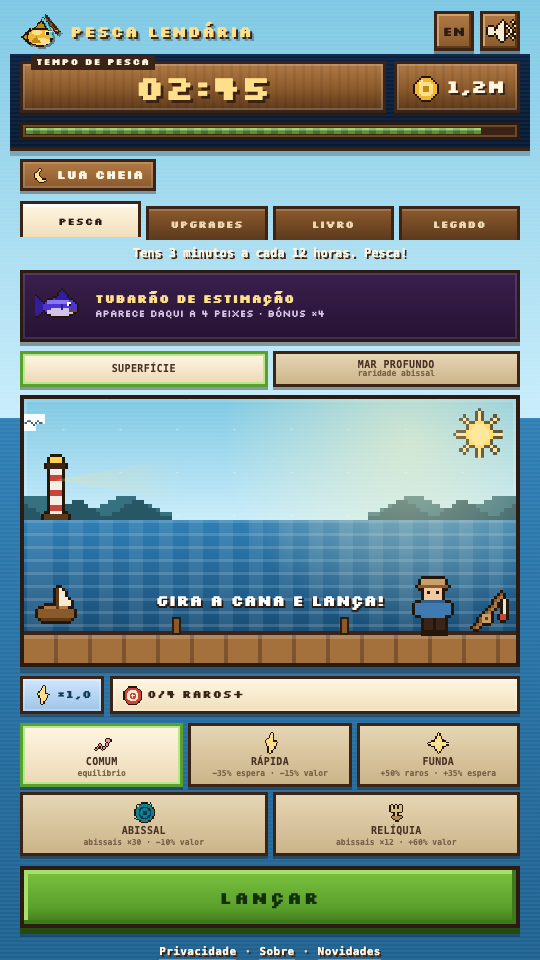
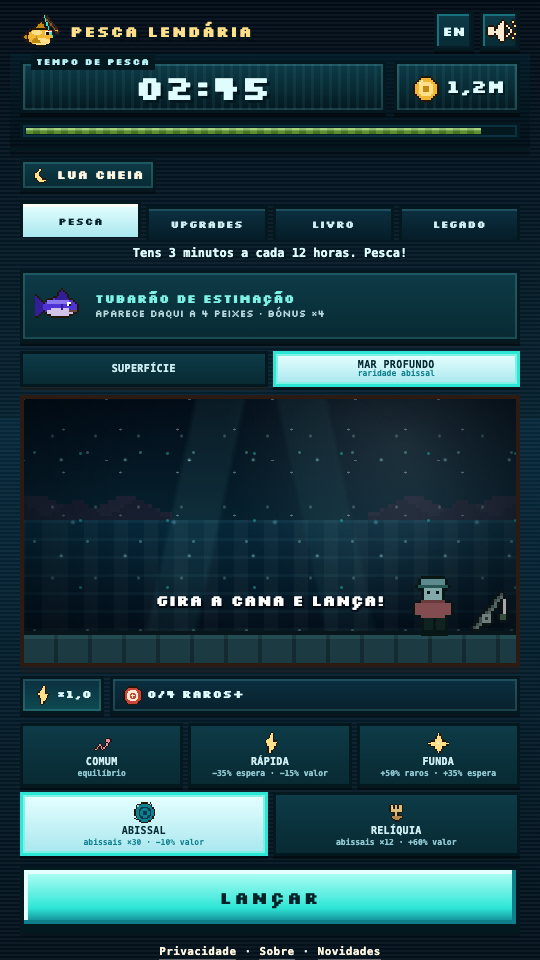
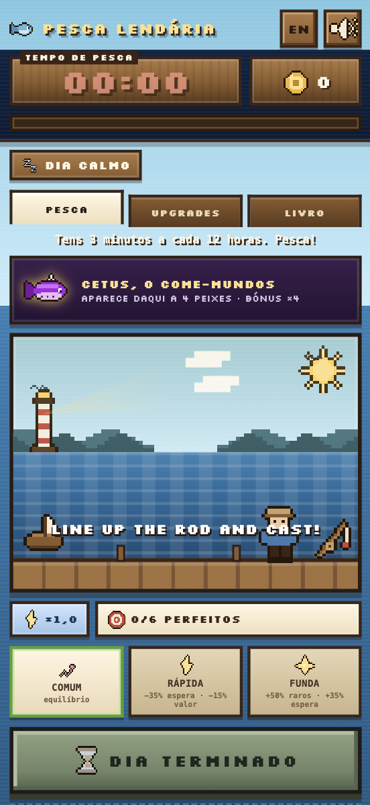

<p align="center">
  
</p>

<h1 align="center">Pesca Lendária</h1>

<p align="center">
  <strong>Tycoon de pesca pixel art. 180 segundos a cada 12 horas.</strong>
</p>

<p align="center">
  
  
  
  
</p>

<p align="center">
  
  
</p>

<p align="center">
  <sub>Superfície · Mar Profundo</sub>
</p>

> Um jogo de browser feito para ser um ritual curto: entras, pescas durante 3 minutos, fechas e voltas 12 horas depois. Sem conta, sem backend e sem pressa.

## Funcionalidades

- **180 segundos a cada 12 horas** — o tempo só desconta com o separador visível.
- **45 espécies e 7 raridades** — 30 de superfície e 15 abissais, com nomes propositadamente parvos.
- **Dois biomas**: Superfície e **Mar Profundo**, com cenário, fundo de página, botões próprios e transição de água com peixes e chegada à superfície.
- **Chefe, evento e missão diários** — o chefe abissal aparece a cada 4 dias e dá bónus ×6.
- **Livro de Pesca** — completa raridades para ganhar bónus permanentes de valor.
- **5 upgrades** (Cana, Isco, Barco, Pescador e Geleira) e **prestígio** com estrelas permanentes.
- **Legado** — 37 conquistas dão **Pérolas** para 9 melhorias permanentes.
- **Pescadores offline** — a equipa continua a render até 24 horas (ou mais, com Legado).
- **PT / EN** — deteta o idioma do browser e permite trocar no cabeçalho.
- **Pixel art 100% desenhada em código** — peixes, chefe, farol, pescador, ícones e eventos são `<canvas>`. No jogo, os únicos assets estáticos são o logótipo e o favicon; as capturas em `assets/img/` são só para o README.

## Jogar

O projeto é estático. Não há build, `npm install` nem bundler.

```bash
python3 -m http.server 8080
# abre http://localhost:8080
```

Também podes publicar diretamente no **Vercel** ou no **GitHub Pages** (ver [Publicar](#publicar)).

## O ciclo

1. Escolhes o isco e carregas em **LANÇAR**.
2. Esperas pela mordida e tocas quando o marcador estiver na zona verde.
3. Um acerto **perfeito** dá +50% e sobe o combo; falhar zera.
4. Gastas as moedas em upgrades, completas o livro e, aos 30 níveis, podes prestigiar.
5. Na Época 3 abre o **Mar Profundo**; a partir daí a coleção e o Legado continuam a crescer.

## Progressão

| Sistema | O que faz |
|---|---|
| **Upgrades** | Cana (espera/zona), Isco (raridade), Barco (valor), Pescador (offline) e Geleira (Raro+). |
| **Livro** | Cada raridade completa dá +5% de valor permanente; há um livro de superfície e outro abissal. |
| **Prestígio** | Aos 30 níveis podes recomeçar upgrades por estrelas permanentes (+8% de valor cada). |
| **Mar Profundo** | Modo de pesca separado, raridade Abissal (×5000), iscas Abissal/Relíquia e chefe abissal. |
| **Legado** | Conquistas dão Pérolas; gastas em tempo de sessão, sorte, offline, anúncios, valor, combo e mais. |

## Capturas

<details>
<summary>Ver a captura da versão inicial (10/11/2026)</summary>
<p align="center">
  
</p>
</details>

## Estrutura do projeto

```text
/
├── index.html              # entrada do jogo (só markup)
├── sobre.html              # página institucional
├── privacidade.html        # política de privacidade
├── ads.txt                 # verificação do AdSense (tem de ficar na raiz)
├── vercel.json             # proxies first-party de analytics
├── .editorconfig           # convenções de edição
├── .gitignore
├── README.md
├── ROADMAP.md              # ideias e camadas futuras
└── assets/
    ├── css/
    │   ├── styles.css      # todo o CSS do jogo
    │   └── legal.css       # CSS partilhado por sobre/privacidade
    ├── img/
    │   ├── logo.png
    │   ├── favicon-32.png
    │   ├── favicon-64.png
    │   ├── apple-touch-icon.png
    │   ├── screenshot-surface.png
    │   ├── screenshot-abyss.png
    │   └── screenshot-2026-11-10.png
    └── js/
        ├── config.js       # CONFIG, TEXTOS, ADS, ANALYTICS
        ├── data.js         # PEIXES, RARIDADES, UPGRADES, EVENTOS, CONQUISTAS, LEGADO
        ├── updates.js      # versão atual e changelog (PT/EN)
        ├── sprites.js      # motor de pixel art em canvas
        ├── game.js         # estado, regras, render e ciclo de pesca
        └── main.js         # arranque, eventos globais e loop
```

Regras de organização:

- **Raiz = pontos de entrada e ficheiros de plataforma.** `ads.txt` e `vercel.json` têm de ficar na raiz; as páginas legais também, para os URLs públicos não mudarem.
- **Assets em `assets/`**, separados por tipo (`css/`, `js/`, `img/`). O browser carrega tudo tal como está.
- **Ordem dos scripts** (clássicos, partilham o mesmo escopo global): `config.js` → `data.js` → `updates.js` → `sprites.js` → `game.js` → `main.js`. O `main.js` chama `iniciar()` no fim.
- **Configuração primeiro, conteúdo depois**: equilíbrio em `config.js`; peixes/eventos/conquistas em `data.js`; sprites em `sprites.js`.
- **Planeamento** em [ROADMAP.md](ROADMAP.md).

## Configuração e equilíbrio

A economia foi pensada para ~3 semanas de jogo até maximizar os 5 upgrades. Os valores base dos peixes são planos por raridade; quem escala é o multiplicador de raridade (1× a 5000×), os eventos e o combo.

Tudo o que é número de equilíbrio está em `assets/js/config.js`:

| Quero… | Variável |
|---|---|
| Tempo por sessão | `DIA_SEGUNDOS` |
| Ritmo do ciclo | `ESPERA_MIN_MS`, `ESPERA_MAX_MS`, `BARRA_MS` |
| Dificuldade do timing | `ZONA_BASE`, `JANELA_PERFEITA` |
| Combo | `COMBO_MAX`, `COMBO_PASSO`, `BARRA_ACELERA_COMBO` |
| Economia | `CUSTO_BASE`, `CRESCIMENTO` |
| Upgrades | `BARCO_VALOR_NIVEL`, `GELEIRA_VALOR_NIVEL`, `ISCO_*` |
| Iscas | `ISCAS` |
| Chefe do dia | `CHEFE_*` |
| Coleção | `COLECAO_BONUS` |
| Prestígio | `EPOCA_NIVEIS`, `EPOCA_POR_NIVEL`, `EPOCA_ESTRELA` |
| Mar Profundo | `ABISMO_EPOCA`, `ABISMO_PESO`, `ISCO_ABISSO`, `CHEFE_BONUS_ABISMO`, `CHEFE_ABISMO_DIAS` |
| Passivo | `PESCADOR_MOEDAS_MIN`, `PESCADOR_ESCALA`, `OFFLINE_CAP_HORAS` |
| Missões | `MISSAO` |
| Anúncios | `ANUNCIO_SEGUNDOS`, `ANUNCIO_MAX_DIA` |

Conteúdo (peixes, eventos, conquistas e Legado) está em `assets/js/data.js`. Para trocar o tema:

- **Peixes:** `PEIXES` (`id, nome, emoji, r, base`). O emoji é a assinatura que escolhe a silhueta: 🐟 peixe, 🦈 tubarão, 🐡 peixe-balão, 🐙 polvo, 🦑 lula, 🦀 caranguejo, 🐋/🐳 baleia, 🐉 dragão.
- **Eventos:** `EVENTOS` com efeitos em `fx`; o ícone é desenhado por `spriteEvento(id)`.
- **Upgrades:** `UPGRADES_DADOS` + `SPRITE_UP` + `efeitoTexto()`.
- **Cores:** variáveis CSS em `:root`, em `assets/css/styles.css`.

## Desenvolvimento

### Save e testes

O progresso fica em `localStorage`, na chave `pescaLendaria.v2`. Não há botão para apagar progresso (para evitar acidentes). Para testar do zero:

1. DevTools → Application → Local Storage → apagar `pescaLendaria.v2`.
2. Ou abrir numa janela anónima.

### Novidades / changelog

O histórico está em `assets/js/updates.js` (`APP_VERSION` + `ATUALIZACOES`). O jogo mostra o modal **uma vez por versão** e tem o link **Novidades** no rodapé. Para anunciar uma alteração:

1. Acrescenta uma entrada nova no topo de `ATUALIZACOES` (PT e EN).
2. Sobe `APP_VERSION`.
3. Faz deploy. Quem já tinha visto a versão anterior recebe o aviso.

### Idioma

O jogo deteta o idioma do browser (português → PT, resto → EN) e tem um botão **EN/PT** no cabeçalho. A escolha fica guardada. Para forçar num link: `?lang=en` ou `?lang=pt`.

<details>
<summary><strong>Analytics (GoatCounter / Vercel)</strong></summary>

O jogo usa **GoatCounter** através de um proxy first-party no Vercel (`vercel.json`), para reduzir o bloqueio por adblockers:

- `/count` → `https://pescalendaria.goatcounter.com/count`
- `/count.js` → `https://gc.zgo.at/count.js`

Em `assets/js/config.js`:

```js
const ANALYTICS = {
  ativo: true,
  provedor: 'goatcounter',
  goatcounter: '/count',
  script: '/count.js',
  ga4: 'G-XXXXXXXXXX',
  painel: 'https://pescalendaria.goatcounter.com',
  vercelAtivo: true
};
```

- Dashboard: <https://pescalendaria.goatcounter.com>
- Divulga com `?ref=reddit_incremental`; cada origem aparece como `origem/...`.
- Abre o site com `?dono` para aparecer **Ver estatísticas** no separador Upgrades.
- Eventos enviados: `captura`, `chefe`, `prestigio`, `partilha`, `anuncio`, `abisso`.

**Vercel Web Analytics:** ativa no painel do Vercel (Project → Analytics) e mantém `vercelAtivo: true`. É servido do teu domínio, por isso sofre menos com adblockers.

> Nenhum analytics JavaScript conta 100%. Para contagens server-side (incluindo quem bloqueia JS/analytics) só com logs de servidor ou CDN.

</details>

<details>
<summary><strong>Anúncios (AdSense / rewarded / GameDistribution)</strong></summary>

Tudo configurado em `const ADS`, em `assets/js/config.js`.

### AdSense no site

O publisher ID `ca-pub-5123386402594330` está no `index.html` e no `ads.txt`.

1. Cria duas unidades de 320×100 no AdSense.
2. Preenche `ADS.adsense.slotMain` e `ADS.adsense.slotEnd`.
3. Ativa a mensagem de consentimento RGPD no AdSense (**Privacy & messaging**) e faz deploy.

O jogo mostra um aviso de consentimento; só carrega anúncios depois de **Aceitar**. Sem slots configurados, só funcionam os Auto ads (se ativados).

### Rewarded (+60s)

O botão “Ver anúncio: +60s” usa a **Ad Placement API / H5 Games Ads** (a mesma conta AdSense):

- `adConfig({ preloadAdBreaks: 'on', sound: 'on' })`
- `adBreak({ type: 'reward' })`
- a recompensa só é dada com `breakStatus === 'viewed'`
- o relógio de pesca pausa durante o anúncio
- se a API não estiver disponível, o botão diz “anúncio indisponível” e **não dá tempo**
- para testar sem rede: `ADS.rewarded = 'simulado'`

### GameDistribution

Para publicar no portal, muda `ADS.modo = 'gamedistribution'`. O SDK trata de rewarded e interstitials, mas só faz sentido quando o jogo é servido no portal com o game ID associado.

### Notas

- O `#ad-banner` (320×100) fica reservado no fim do dia.
- O consentimento é guardado em `pescaLendariaConsent.v1`.
- Sem consentimento não há pedidos ao Google.

</details>

## Publicar

### GitHub Pages

1. `git push`
2. **Settings → Pages** → branch `main`, pasta `/ (root)`.

### Vercel

O `vercel.json` já tem os proxies `/count` e `/count.js`. Para ativar o Vercel Web Analytics, segue os passos no painel e mantém `vercelAtivo: true`.

Em qualquer um dos casos, `ads.txt` tem de continuar na raiz do domínio.

## Contacto

Feito por **Gabriel Maria** — [github.com/gabrielmaria](https://github.com/gabrielmaria).

Dúvidas, bugs ou ideias? Abre uma issue no repositório.
